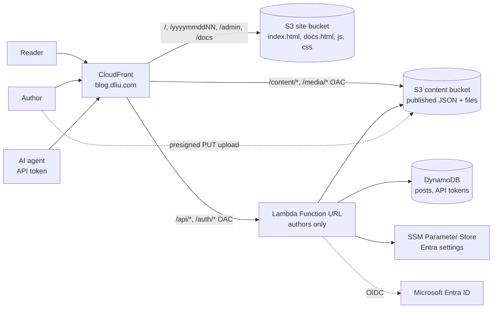

# DL blog

The blog at **https://blog.dliu.com**: a small, serverless blog. It looks like the other dliu.com apps and is just a list of posts; writing works like WordPress (drafts, publish, attach pictures and files).

Technical architecture, cost and security are explained at https://blog.dliu.com/docs.

It replaces the old WordPress container, which ran around the clock. The new blog has **no server running when nobody is using it**:

- Readers get static files and pre-rendered JSON from CloudFront and S3. Reading the blog never runs a Lambda function.
- A Lambda function runs only when an author signs in, saves a post or uploads a file.

## Architecture



| Piece | Role |
| --- | --- |
| CloudFront | Single domain, TLS, security headers, page routing and old-link redirects. The redirects are handled by a CloudFront Function (`functions/viewer-request.js`). |
| Site bucket | Static frontend from `web/`. |
| Content bucket (private) | `content/index.json` (list of published posts), `content/posts/<postId>.json` (one file per published post) and `media/<postId>/<fileId>/<name>` (uploaded files). |
| Lambda (`lambda/api`) | Authoring API and Microsoft sign-in. Reached only through CloudFront (Function URL with IAM auth + OAC). Reserved concurrency is 10. |
| DynamoDB | `Posts` is the source of truth for posts, drafts included (on-demand, point-in-time recovery, deletion protection). `Tokens` holds API tokens as SHA-256 hashes, with TTL. |

Cost at low traffic is a few cents a month for requests and storage, plus the Route 53 zone the other dliu.com apps already share. Nothing is billed per hour.

## Post IDs and URLs

Every post gets an ID of the form `yyyymmddNN`: the UTC date it was created plus a two-digit counter, starting at `00` each day (`2026102700`, `2026102701`, …). The post lives at `https://blog.dliu.com/<postId>`, for example `https://blog.dliu.com/2026102701`. The ID never changes, so editing a title doesn't break links. Up to 100 posts can be created per day.

## Writing posts

1. Click **Sign in** at the top of any page (or open `/admin`) and sign in with a Microsoft account in the `dliu.com` organisation.
2. Click **＋ New post**. Write the title and the body in Markdown. Use the toolbar or the **Preview** tab to check how it looks.
3. Add pictures and files by dragging them onto the text, pasting them, clicking **🖼 Picture or file**, or using the **Files** box:
   - Pictures dropped on the text are inserted where the cursor is.
   - Other files appear under **Attachments** on the post page.
   - Each file can be up to 100 MB, with up to 100 files per post.
4. Click **Save draft** (or press Ctrl/⌘+S) to keep the post private, or **Publish** to make it public. On a published post, **Update** saves changes and **Unpublish (back to draft)** hides it again. **Delete post** removes the post and its files.

Every page has a **Docs** button in the header. While you are signed in, the header also shows **Edit** (on a post page), **Posts** (all posts and drafts), **＋ New post** and **Sign out**; on narrow phones the Docs button then moves to the footer link to save room.

Images, PDFs, plain text, audio and video open in the browser. Other file types are always downloaded rather than displayed.

## API tokens for AI agents

Another AI agent or script can write posts through the API, without controlling a browser:

1. Signed in, open **Posts → API tokens** (`/admin/tokens`), enter a name and an expiry, and click **Generate token**.
2. **Copy command** and run it in Terminal on the agent's computer, then **Copy token** and paste it at the prompt. Like `~/.aws/credentials`, the token is stored in `~/.dliu_credentials` (mode 600), in INI format with one section per app, so the file can hold other tokens too:

   ```ini
   [blog]
   token = blog_0123456789ab_...
   ```

   The command keeps other sections, doesn't echo the token or put it in the shell history, and clears the macOS clipboard. Agents can be pointed at another file with `DLIU_CREDENTIALS_FILE`.
3. **Copy instructions** and paste them into the agent. They don't contain the token; they tell the agent to read the guide at `https://blog.dliu.com/docs/api.md` (also shown at `/docs/api`) and to use its bash or Python helpers, which read the token from the file per request.

A token can list, read, create, edit, publish and unpublish posts and upload files. It can't delete posts or manage tokens. Revoke tokens on the same page. The API takes the token as `Authorization: Bearer …`; the CloudFront viewer function copies it to `x-blog-token`, because origin access control replaces `Authorization`.

## Repository layout

```
web/            frontend (vanilla JS, no build step): index.html, app.js, markdown.js, style.css,
                docs.html, docs.js, docs.css, diagram.js (the /docs page),
                docs-api.html, docs-api.js, docs-nav.js, docs/api.md (API guide for agents)
lambda/api/     authoring API: routes (index.js), posts, API tokens, S3 signing, DynamoDB store, Entra auth, config
functions/      CloudFront viewer-request function (routing + old-link redirects)
lib/, bin/      AWS CDK stack (BlogSite)
scripts/        dev server with in-memory store, set-secrets.sh
test/           Jest tests (API, S3 signing, routing, markdown sanitising, stack)
archive/        the previous WordPress Docker setup, kept for reference only
```

## Local development

```sh
make install
make dev        # http://localhost:8787
```

The dev server uses an in-memory store and files, and has a fake sign-in, so it needs no AWS access. Run the tests with:

```sh
make test
```

## Sign-in setup (Microsoft Entra)

You only need to do this once, and again whenever the client secret expires.

1. In the Entra admin centre, create an app registration in your tenant (single tenant). Add a **Web** redirect URI: `https://blog.dliu.com/auth/callback`.
2. Create a client secret.
3. Run `make set-secrets`. It asks for the client ID, the client secret and the tenant ID, and stores them in SSM under `/blog/` (the secret as a SecureString). Values never go on the command line or into the repository.

The Lambda reads these values at runtime, so after renewing a secret you only need to run `make set-secrets` again; no redeploy is needed, and the new value is picked up within five minutes. Sessions are signed with a key derived from the secret, so renewing it signs everyone out.

Only accounts in the `dliu.com` domain may write. Set the `ALLOWED_DOMAIN` environment variable on the function to change this.

## Deploy

You need AWS credentials for the account that hosts dliu.com. The stack deploys to `eu-west-1`; the certificate is created in `us-east-1`.

```sh
make deploy     # runs the tests, then cdk deploy BlogSite
make outputs    # show stack outputs
make diff       # preview changes
```

CDK context options:

- `-c subdomain=blog-next` deploys to another hostname, for example to try changes before switching.
- `-c trafficLogging=false` turns off the traffic.dliu.com integration.

The DynamoDB table and the content bucket are **retained** when the stack is deleted, so posts and files survive a teardown.

## Caching

- The frontend files and `content/*.json` are served with `no-cache`, so CloudFront and browsers revalidate them. A published edit appears immediately.
- Files under `/media/` are cached for a day. A replaced file gets a new ID, so its URL changes too.
- Publishing, editing or unpublishing a post rewrites `content/posts/<postId>.json`. It also rebuilds `content/index.json` from DynamoDB.

## Routes and old links

| Path | Result |
| --- | --- |
| `/` | List of posts. `/?s=word` searches titles and excerpts; `/?m=202510` shows one month. |
| `/<postId>` | The post, e.g. `/2026102701` |
| `/admin` | All posts and drafts (signed in) |
| `/admin/tokens` | Create and revoke API tokens (signed in) |
| `/docs` | Architecture, cost and security |
| `/docs/api`, `/docs/api.md` | API guide for agents (page and Markdown) |
| `/posts/<postId>` | `/<postId>` (301) |
| `/2025/04/` | `/?m=202504` (301) |
| `/<old-wordpress-slug>/`, `/page/2/` | `/` (301) |
| `/wp-admin`, `/wp-login.php` | `/admin` (302) |

## Security

- **Network access:** the Lambda Function URL and both buckets accept requests only from this CloudFront distribution, via OAC. Because of this, the browser signs every write request body with the `x-amz-content-sha256` header.
- **Writes:** every write needs either a signed-in session cookie and an `Origin` header equal to the site URL, or a valid API token. Tokens are 256-bit secrets stored only as hashes, expire, can be revoked, and can't delete posts or manage tokens.
- **Threat model:** see the Security tab at `/docs#security`.
- **Sign-in session:** the session is a signed, HTTP-only `__Host-` cookie. The short-lived sign-in cookie is signed with a different key and carries a different `typ`, so it can't be replayed as a session.
- **Rendering:** Markdown is rendered on the client with a strict allow-list. Raw HTML and `javascript:` URLs are dropped. A video.dliu.com link on its own line (or its pasted embed code) becomes the player; the iframe is rebuilt from the video ID and the CSP allows frames only from video.dliu.com.
- **Headers:** CloudFront sends a strict Content-Security-Policy and HSTS.
- **Uploads:** files go directly to S3 through short-lived presigned URLs into a `pending/` prefix. They are moved into `media/` only when the post is saved. Abandoned uploads expire after a day.

## Traffic monitoring

The site sends CloudFront logs to the shared traffic monitor (https://traffic.dliu.com). That repository lists it as `blog` in its `config/sites.json`.

## Legacy WordPress

The previous site was a WordPress Docker image on ECS with an EFS volume. Its configuration is kept under `archive/wordpress/` for reference. The old AWS resources can be removed once you no longer need them:

- the ECS service or task
- the `BlogStorage` EFS stack
- the Docker image and its Jenkins jobs

The old posts and images were not migrated automatically.
