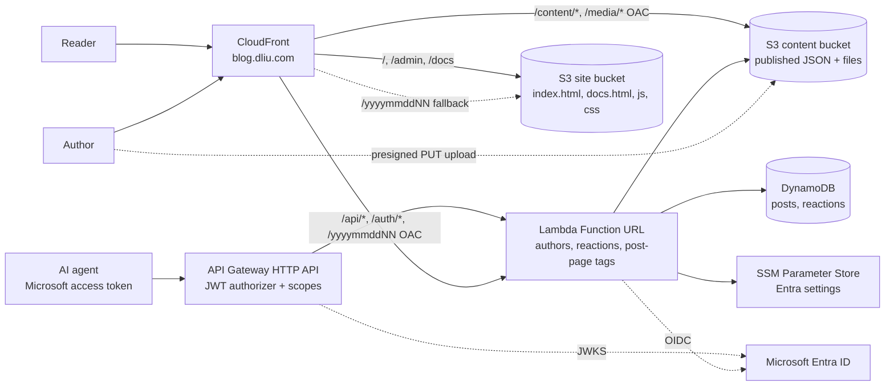

# DL blog

The blog at **https://blog.dliu.com**: a small, serverless blog. It looks like the other dliu.com apps and is just a list of posts; writing works like WordPress (drafts, publish, attach pictures and files).

Technical architecture, cost and security are explained at https://blog.dliu.com/docs.

It replaces the old WordPress container, which ran around the clock. The new blog has **no server running when nobody is using it**:

- Readers get static files and pre-rendered JSON from CloudFront and S3.
- A Lambda function runs when an author signs in, saves a post or uploads a file. It also adds share-preview tags to post pages, which CloudFront caches for five minutes.

## Architecture



| Piece | Role |
| --- | --- |
| CloudFront | Single domain, TLS, security headers, page routing and old-link redirects. The redirects are handled by a CloudFront Function (`functions/viewer-request.js`). |
| Site bucket | Static frontend from `web/`. |
| Content bucket (private) | `content/index.json` (list of published posts), `content/posts/<postId>.json` (one file per published post) and `media/<postId>/<fileId>/<name>` (uploaded files). |
| API Gateway HTTP API | The managed API for agents and scripts (`MicrosoftApiUrl` output, an `execute-api` origin). A JWT authorizer checks Microsoft access tokens and each route's scope (`lambda/api/routes.json`); the Lambda checks the rest (`lambda/api/api-access.js`). |
| Media invalidator (`lambda/invalidate`) | S3 sends `media/` deletes and non-app uploads to EventBridge, then an SQS queue; once a minute this function clears those paths from CloudFront. It may only create invalidations on this distribution. |
| Lambda (`lambda/api`) | Authoring API, Microsoft sign-in and post pages with link-preview tags (`page.js`). Reached only through CloudFront (Function URL with IAM auth + OAC). Reserved concurrency is 10. |
| DynamoDB | `Posts` is the source of truth for posts, drafts included (on-demand, point-in-time recovery, deletion protection). `Reactions` holds per-post counts (`pk=post#<id>`, `sk=counts`), each reader's reaction (`sk=visitor#<dl_vid>`) and hashed-IP rate-limit windows (`pk=viewer#<sha256>`, TTL). |

Cost at low traffic is a few cents a month for requests and storage, plus the Route 53 zone the other dliu.com apps already share. Nothing is billed per hour.

## Post IDs and URLs

Every post gets an ID of the form `yyyymmddNN`: the UTC date it was created plus a two-digit counter, starting at `00` each day (`2026102700`, `2026102701`, …). The post lives at `https://blog.dliu.com/<postId>`, for example `https://blog.dliu.com/2026102701`. The ID never changes, so editing a title doesn't break links. Up to 100 posts can be created per day.

## Writing posts

1. Click **Sign in** at the top of any page (or open `/admin`) and sign in with a Microsoft account in the `dliu.com` organisation.
2. Click **＋ New post**. Write the title and the body in Markdown. Use the toolbar or the **Preview** tab to check how it looks.
3. Add pictures and files by dragging them onto the text, pasting them, clicking **🖼 Picture or file**, or using the **Files** box:
   - Pictures dropped on the text are inserted where the cursor is.
   - Other files appear under **Attachments** on the post page.
   - Each file can be up to 100 MB, with up to 100 files per post.
4. Click **Save draft** (or press Ctrl/⌘+S) to keep the post private, or **Publish** to make it public. On a published post, **Update** saves changes and **Unpublish (back to draft)** hides it again. **Delete post** removes the post and its files.

Every page has a **Docs** button in the header. While you are signed in, the header also shows **Edit** (on a post page), **Posts** (all posts and drafts), **＋ New post** and **Sign out**; on narrow phones the Docs button then shows only its icon to save room.

Images, PDFs, plain text, audio and video open in the browser. Other file types are always downloaded rather than displayed.

## Look

Every dliu.com site shares one light look from https://files.dliu.com/dliu.com/README.md. Each page loads the shared `ui/v1/dl.css` first (the docs pages then `ui/v1/dl-docs.css`), then `/style.css`, which keeps only blog-specific rules (editor, toolbar, reactions, post body, file lists) on the shared `--dl-*` variables. The header, footer, buttons, notices, fields, tabs and the language switch use the shared `dl-*` classes; no shared JavaScript is loaded. The header and favicon keep the blog's own logo (`web/logo.svg`, `web/favicon.ico`); every footer starts with the shared DL logo from `files.dliu.com/dliu.com/favicon.png`, linking to dliu.com. The CSP allows stylesheets only from `'self'` and `https://files.dliu.com/dliu.com/ui/`. `test/shared-ui.test.js` guards this.

## Languages

The site is in Chinese and English. It follows the browser's language (any `zh-*` is Chinese, everything else English) until the reader picks one with the 中文 / English switch at the end of the header (the shared `dl-language` markup; 文/A on phones); that choice is saved in the browser (`localStorage`, key `blog-language`). `web/i18n.js` holds the language, the `t(中文, English)` helper and the Chinese text for API errors; static text in the HTML pages carries its Chinese in `data-zh` attributes. Posts are shown as written, and the agent guide `/docs/api.md` (and `/docs/api`) stays in English.

## API for AI agents and scripts

Agents and scripts write posts through a separate managed API, not the website. It accepts Microsoft-issued user access tokens from Central Microsoft sign-in at https://auth.dliu.com, which also documents how to obtain, save and send them (https://auth.dliu.com/docs/api). The blog has no API tokens of its own any more.

The API guide is `web/docs/api.md`, served at https://blog.dliu.com/docs/api.md (and `/docs/api`). It contains `{{MICROSOFT_API_URL}}`, which the deployment replaces with the stack's `MicrosoftApiUrl` output, so readers never need AWS access to find the API. To let an AI agent write a post, save a token at auth.dliu.com and give the agent only that guide's link and a specific task.

| Route | Scope |
| --- | --- |
| `GET /api/me`, `GET /api/posts`, `GET /api/posts/{postId}` | `blog.read` |
| `POST /api/posts`, `PUT /api/posts/{postId}`, `POST /api/posts/{postId}/files`, `PUT /api/posts/{postId}/files/{fileId}` | `blog.write` |
| `DELETE /api/posts/{postId}`, `DELETE /api/posts/{postId}/files/{fileId}` | `blog.delete` |

Every route also needs the Microsoft-assigned user role **dliu API user** (`api.access`), one role shared by all dliu.com APIs; the per-route `blog.*` scope still decides what the token can do on the blog. The gateway validates the signature, the tenant's v2 issuer, the audience, token times and the route scope. The Lambda additionally requires the configured gateway ID, tenant, audience, the approved client (`azp`), the user's `oid` and `sub` and the role, and that the method and path match the route. Website cookies are never accepted on the managed API, and bearer tokens are never accepted on the website's `/api/*`.

`scripts/api-client.js` is a small client (Node.js 22+): `BLOG_API_URL=<MicrosoftApiUrl> node scripts/api-client.js GET /api/me`, or `... upload <postId> <file> <mime-type>`. It reads `~/.dliu_token` per request (or `BLOG_API_ACCESS_TOKEN` / `BLOG_API_TOKEN_FILE`) and refuses redirects.

## Repository layout

```
web/            frontend (vanilla JS, no build step): index.html, app.js, i18n.js (Chinese/English), markdown.js, style.css,
                docs.html, docs.js, diagram.js (the /docs page; shared dl.css + dl-docs.css),
                docs-api.html, docs-api.js, docs-nav.js, docs/api.md (API guide for agents; the API URL is filled in at deploy)
lambda/invalidate/ clears deleted or changed media from CloudFront (S3 event -> SQS -> this function)
lambda/api/     authoring API: routes (index.js), managed API routes and checks (routes.json, api-access.js), posts,
                S3 signing, DynamoDB store, Entra auth, config
functions/      CloudFront viewer-request function (routing + old-link redirects)
lib/, bin/      AWS CDK stack (BlogSite)
scripts/        dev server with in-memory store, set-secrets.sh, api-client.js (managed API client)
test/           Jest tests (API, S3 signing, routing, markdown sanitising, languages, shared UI, stack)
archive/        the previous WordPress Docker setup, kept for reference only
```

## Local development

```sh
make install
make dev        # http://localhost:8787
```

The dev server uses an in-memory store and files, and has a fake sign-in, so it needs no AWS access. Run the tests with:

```sh
make test
```

## Sign-in setup (Microsoft Entra)

You only need to do this once, and again whenever the client secret expires.

1. In the Entra admin centre, create an app registration in your tenant (single tenant). Add a **Web** redirect URI: `https://blog.dliu.com/auth/callback`.
2. Create a client secret.
3. Run `make set-secrets`. It asks for the client ID, the client secret and the tenant ID, and stores them in SSM under `/blog/` (the secret as a SecureString). Values never go on the command line or into the repository.

The Lambda reads these values at runtime, so after renewing a secret you only need to run `make set-secrets` again; no redeploy is needed, and the new value is picked up within five minutes. Sessions are signed with a key derived from the secret, so renewing it signs everyone out.

Only accounts in the `dliu.com` domain may write. Set the `ALLOWED_DOMAIN` environment variable on the function to change this.

### Managed API settings

The managed API reuses the shared dliu API app registration (it exposes the `blog.read`, `blog.write` and `blog.delete` scopes and the user-only **dliu API user** role, `api.access`, shared by all dliu.com APIs; the token carries the value `api.access`). Assign it only to the account meant to use the API: other `dliu.com` organisation accounts keep normal website sign-in and cookies but get no API rights. Before deploying, create these non-secret String parameters; CloudFormation reads them at deploy time:

| Parameter | Value |
| --- | --- |
| `/blog/api-tenant-id` | The Microsoft Entra tenant ID |
| `/blog/api-audience` | The shared dliu API application ID (the token audience) |
| `/blog/api-client-id` | The same application ID (the only approved SPA client, `azp`) |

Changing them needs a redeploy. Deploy with `-c microsoftApi=false` to leave the managed API out.

## Deploy

You need AWS credentials for the account that hosts dliu.com. The stack deploys to `eu-west-1`; the certificate is created in `us-east-1`.

```sh
make deploy     # runs the tests, then cdk deploy BlogSite
make outputs    # show stack outputs
make diff       # preview changes
```

CDK context options:

- `-c subdomain=blog-next` deploys to another hostname, for example to try changes before switching.
- `-c trafficLogging=false` turns off the traffic.dliu.com integration.
- `-c microsoftApi=false` leaves out the managed API (API Gateway).

The DynamoDB tables and the content bucket are **retained** when the stack is deleted, so posts and files survive a teardown.

## Caching

- CloudFront uses every edge location (price class All), since most readers are in Europe and Asia, and serves HTTP/3.
- The HTML shells (`*.html`) and `content/*.json` are served with `no-cache`, so CloudFront and browsers revalidate them. A published edit appears immediately.
- The other site files (scripts, styles, images, `docs/api.md`) are uploaded with `public, max-age=300, s-maxage=86400, stale-while-revalidate=86400`. CloudFront keeps them for a day, and every deploy invalidates `/*`. Browsers reuse them for five minutes, so just after a deploy a returning reader may briefly run the previous scripts. `make deploy` uploads them first (`SiteContent`), then the HTML shells (`SitePages`); each upload syncs and prunes only its own files.
- Files under `/media/` are cached for a day. A replaced file gets a new ID, so its URL changes too.
- Automatic CloudFront clearing (decided per bucket; the 1,000 free invalidation paths a month are shared by every dliu.com site):
  - **Content bucket `media/`: on.** Deleting a file or a post, or changing `media/` in the S3 console, sends an S3 event (EventBridge rule `MediaChanged`, `Object Deleted` and `Object Created` except `CopyObject`) to the `MediaChanges` SQS queue. `MediaInvalidator` takes up to a minute of events at a time and clears `/media/<postId>/<fileId>/*` for one file, `/media/<postId>/*` for several files of a post, or `/media/*` for more than ten posts or an unexpected key. That is usually a few paths a month. Failures are retried until the queue drops them after a day, when CloudFront's copy has expired anyway. Browsers that already loaded a deleted file may keep it for up to a day.
  - The app's own media writes are not cleared: saving a file copies it to a brand-new key that was never cached.
  - **Site bucket: off.** Only `make deploy` changes it, and each deploy already clears `/*`.
  - **`content/*.json`: off.** It is `no-cache`, so changes show at once.
  - **`pending/` and the logging buckets: off.** CloudFront doesn't serve them, and logs are added all the time.
- Post pages (`/<postId>`) are `index.html` with the post's title, excerpt and first picture as Open Graph tags, so WeChat, iMessage, Slack and others show a preview card. The viewer function puts the ID in `x-blog-post`. The `20????????` behaviour asks the Lambda (an origin group) and caches the page per ID for five minutes. A 404 (not published) or a Lambda error falls back to the plain `index.html` in the site bucket. `web/share.png` is the picture for posts without one.
- Reactions (`GET`/`POST /api/reactions/<postId>`) are never cached. The page loads them after the post, so readers call the Lambda once per post view; if it fails, the buttons stay hidden.
- Signed-in authors also see who reacted: `GET /api/posts/<postId>/reactions` (website session only, never the Microsoft API) lists each visitor ID, reaction and time, and the page links each ID to `https://traffic.dliu.com/visitor?visitor=<id>` in the private traffic monitor. Guests and readers only get counts and their own reaction.
- Publishing, editing or unpublishing a post rewrites `content/posts/<postId>.json`. It also rebuilds `content/index.json` from DynamoDB.

## Routes and old links

| Path | Result |
| --- | --- |
| `/` | List of posts. `/?s=word` searches titles and excerpts; `/?m=202510` shows one month. |
| `/<postId>` | The post, e.g. `/2026102701`. `/<postId>/` redirects to it. |
| `/admin` | All posts and drafts (signed in) |
| `/docs` | Architecture, cost and security |
| `/docs/api`, `/docs/api.md` | API guide for agents (page and Markdown) |
| `/posts/<postId>` | `/<postId>` (301) |
| `/2025/04/` | `/?m=202504` (301) |
| `/<old-wordpress-slug>/`, `/page/2/` | `/` (301) |
| `/wp-admin`, `/wp-login.php` | `/admin` (302) |

## Security

- **Network access:** the Lambda Function URL and both buckets accept requests only from this CloudFront distribution, via OAC. Because of this, the browser signs every write request body with the `x-amz-content-sha256` header.
- **Reactions:** anyone can react to a published post, keyed by the traffic monitor's `dl_vid` cookie. The `POST` must be same-origin JSON and is limited to 60 an hour per IP. The viewer function sets `x-blog-viewer` from CloudFront's viewer IP, so clients can't spoof it, and the IP is stored only hashed, for two hours.
- **Writes:** on the website, every other write needs a signed-in session cookie and an `Origin` header equal to the site URL. The managed API needs a Microsoft access token with the route's `blog.*` scope and the `api.access` role (see API for AI agents and scripts); `blog.write` cannot delete.
- **Threat model:** see the Security tab at `/docs#security`.
- **Sign-in session:** the session is a signed, HTTP-only `__Host-` cookie. The short-lived sign-in cookie is signed with a different key and carries a different `typ`, so it can't be replayed as a session.
- **Rendering:** Markdown is rendered on the client with a strict allow-list. Raw HTML and `javascript:` URLs are dropped. A video.dliu.com link on its own line (or its pasted embed code) becomes the player; the iframe is rebuilt from the video ID and the CSP allows frames only from video.dliu.com.
- **Headers:** CloudFront sends a strict Content-Security-Policy and HSTS.
- **Uploads:** files go directly to S3 through short-lived presigned URLs into a `pending/` prefix. They are moved into `media/` only when the post is saved. Abandoned uploads expire after a day.
- **Managed API throttling:** the HTTP API stage allows 10 requests a second, bursts of 20. The JWT authorizer refuses bad tokens with 401 before throttling counts them.
- **Live penetration test:** `node scripts/pentest.mjs` runs every live check against production without credentials and changes no data. Set `SKIP_RATE=1` to skip the reaction rate test (60 an hour per IP); `CHECK_AWS=1` also reads the stage throttle with the AWS CLI. Results are in the docs Security tab.
- **Secret and dependency scans:** `gitleaks detect --log-opts="--all"` (known test fixtures are listed in `.gitleaksignore`), `npm audit --omit=dev` and `npm audit`.

## Traffic monitoring

The site sends CloudFront logs to the shared traffic monitor (https://traffic.dliu.com). That repository lists it as `blog` in its `config/sites.json`.

Every page also loads the traffic monitor's page script, `https://traffic.dliu.com/t/s.js`, which reports time on page, scroll depth, screen size, load time and script errors per page view to `https://traffic.dliu.com/t/e`. It sets no cookies or storage. Each HTML page loads it with a plain `<script … async>` tag, so it never blocks rendering or the blog's own scripts. If traffic.dliu.com hangs, the browser's loading bar may keep spinning until it times out, though the page is already readable (an accepted trade-off). The script itself swallows its own errors. The CSP allows `https://traffic.dliu.com` in `script-src` and `connect-src` for it.

## Legacy WordPress

The previous site was a WordPress Docker image on ECS with an EFS volume. Its configuration is kept under `archive/wordpress/` for reference. The old AWS resources can be removed once you no longer need them:

- the ECS service or task
- the `BlogStorage` EFS stack
- the Docker image and its Jenkins jobs

The old posts and images were not migrated automatically.
